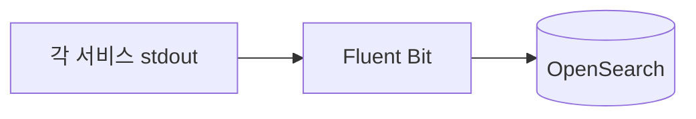
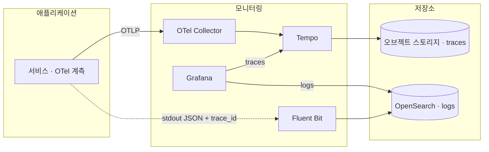

## 🥑 들어가며

서비스를 여러 개로 나눈 뒤로 장애를 고치는 시간보다 **장애가 어디서 났는지 찾는 시간**이 더 길어졌다.

이 글에서는 Kubernetes 위의 여러 서비스가 HTTP와 Kafka로 통신하는 환경에서 분산 트레이싱을 붙인 경험을 정리한다.
설명을 위해 서비스 역할을 orchestrator(요청 조율), datalake(데이터 관리), auth(인증)로 단순화했다. 구성도와 호출 예시는 계측 흐름을 중심으로 축약했다.

최근 몇 주 동안 실제로 겪은 장애를 돌아보면 공통점이 있었다.

- 여러 서비스를 거치는 작업에서 **어느 hop이 어떤 ID로 호출했는지** 서비스마다 로그를 따로 열어 맞춰봐야 했다.
- 두 서비스가 같은 에러 코드를 쓰고 있어서, 응답 바디만 보고 엉뚱한 서비스의 버그로 오판한 적이 있다.
- 인증 프록시(ext_authz)는 통과시켰는데 그 뒤의 서비스가 401을 낸 경우, **401이 어느 지점에서 나왔는지** 찾는 데만 한참 걸렸다.

전부 "서비스 하나 안의 버그"였지만, 그 버그를 찾기까지는 **여러 서비스의 로그를 손으로 이어 붙이는 작업**이 필요했다.
이번 글에서는 이 문제를 풀기 위해 어떤 선택지를 고민했고, 무엇을 골랐고, 구현 과정에서 무엇을 배웠는지 정리해보려 한다.

<br>

## 출발점: 로그는 있지만 흐름이 안 보인다

도입 전의 관측 스택은 사실상 하나였다.



- **로그:** Fluent Bit이 컨테이너 stdout을 수집해 OpenSearch에 쌓는다. 서비스마다 텍스트 로그였다.
- **상관관계:** hop마다 `projectId`, `jobId`, `runId` 같은 비즈니스 ID를 손으로 실어 나르고, 그 ID로 로그를 검색했다.
- **메시 텔레메트리:** Istio(Envoy)가 상태 코드, 지연, connection reset 같은 정보를 준다.

마지막 항목이 처음엔 꽤 든든해 보였다. 이미 떠 있는 Istio가 서비스 간 호출을 전부 보고 있으니까.
그런데 실제로 502/403 장애를 추적해보니, Envoy가 알려주는 건 **"어디서, 언제 실패했는지"**까지였다.
**"왜 실패했는지"**(앱 안에서 어떤 예외가 났는지, 어떤 DB 쿼리가 느렸는지)는 결국 애플리케이션 안을 들여다봐야 했다.

> 프록시 관측과 애플리케이션 로그는 대체 관계가 아니라 보완 관계다.
> 프록시는 실패한 위치를 알려주고, 로그는 실패한 이유를 알려준다.

필요한 건 둘을 잇는 것, 즉 **요청 하나가 서비스들을 거치는 흐름을 하나로 묶어 보는 것**이었다.
이게 분산 트레이싱(Distributed Tracing)이 하는 일이다.

<br>

## 분산 트레이싱을 짧게 정리하면

- **Trace:** 요청 하나가 시스템을 지나가는 전체 경로. 고유한 `trace_id`를 가진다.
- **Span:** trace 안의 작업 단위. "orchestrator가 요청을 받음", "datalake를 호출함", "MongoDB에서 find" 같은 것들이다. 각 span은 부모 span을 가리켜 트리를 이룬다.
- **Context propagation:** 서비스 A가 B를 호출할 때 "나는 이 trace의 이 span에서 너를 부른다"는 정보를 헤더에 실어 보낸다. 표준은 W3C Trace Context의 `traceparent` 헤더다.

```text
traceparent: 00-4bf92f3577b34da6a3ce929d0e0e4736-00f067aa0ba902b7-01
             │  │                                │                └ flags(sampled)
             │  │                                └ 부모 span id
             │  └ trace id (32 hex)
             └ version
```

받는 쪽이 이 헤더를 읽어 같은 trace 아래에 자기 span을 붙이면, 여러 서비스에 흩어진 작업이 하나의 트리로 보인다.
그리고 **로그 한 줄 한 줄에도 같은 `trace_id`를 남기면**, trace에서 로그로, 로그에서 trace로 오갈 수 있다.

<br>

## 고민했던 선택지

처음부터 "OpenTelemetry로 가자"는 아니었다.
새 컴포넌트를 추가할 때는 기능뿐 아니라 운영 부담도 고려해야 했다.
그래서 처음엔 오히려 보수적인 쪽(이미 있는 것부터 쓰기)으로 기울었다.

| 선택지 | 장점 | 결국 고르지 않은 이유 |
|---|---|---|
| requestId 헤더 표준화만 | 새 컴포넌트 없음 | hop별 지연·예외가 시각화되지 않는다. 결국 로그를 손으로 이어 붙이는 지금 방식과 같다 |
| Istio 텔레메트리 + Prometheus | 이미 있는 메시 활용 | 프록시 수준 정보만 있다. 앱 내부 예외·DB 호출이 안 보인다 |
| Zipkin + OpenSearch | 익숙한 조합 | Zipkin 운영 부담 대비 이점이 적고, Grafana 연동이 약하다 |
| OTel Collector → Data Prepper → OpenSearch + Dashboards | 로그와 trace를 한 저장소에 | 아래에서 설명 |
| 상용 SaaS | 운영 부담 없음 | 사용량 과금, 온프레미스 셀프호스팅과 맞지 않음 |

방향을 바꾼 건 "개발할 때 무엇이 가장 편해지는가"라는 질문이었다.
지금까지의 장애가 대부분 **서비스 경계에서 생긴 앱 오류**였으니, 앱 내부까지 hop별로 보이는 트레이싱이 가장 직접적인 해결책이었다.
그래서 requestId 표준화는 버리지 않고 **OTel의 `trace_id`가 그 역할을 겸하도록** 흡수했다.

### 한때 유력했던 안: 전부 OpenSearch로

이미 OpenSearch에 로그가 있으니, trace도 OpenSearch에 넣고 OpenSearch Dashboards로 보면 깔끔해 보였다.
Data Prepper가 OTLP를 받아 OpenSearch에 trace 인덱스를 만들어준다.

그런데 따져보니 걸리는 게 많았다.

- 로그와 trace를 같은 저장소에 넣으면 용량과 메모리 경합을 고려해야 한다.
- Dashboards는 인증을 따로 챙겨야 하고, OpenSearch와 버전을 정확히 맞춰야 한다.

여기서 하나 깨달은 게 있다. **저장소와 UI는 따로 고를 수 있다.**
"로그가 OpenSearch에 있으니 UI도 OpenSearch Dashboards"로 묶어서 생각하고 있었는데,
Grafana는 OpenSearch를 데이터소스로 읽을 수 있다. 로그는 그대로 두고, trace만 다른 곳에 저장해도 한 화면에서 볼 수 있다.

<br>

## 관측 데이터의 흐름

서비스별 배치와 운영 설정을 생략하고, 로그와 trace가 흐르는 경로만 그리면 다음과 같다.



- **Trace:** 앱 → OTLP → **OTel Collector** → **Tempo** → 오브젝트 스토리지
- **로그:** 기존 경로 그대로. 다만 앱 로그를 **JSON + `trace_id`/`span_id`**로 바꾼다.
- **UI:** **Grafana** 하나에서 Tempo(trace)와 OpenSearch(로그)를 함께 보고, `trace_id`로 오간다.

각각을 고른 이유는 이렇다.

- **Tempo:** trace를 OpenSearch에 얹지 않아 로그 저장소와 경합이 없다. 오브젝트 스토리지(MinIO)에 쓰니 저렴하다. Grafana와의 trace↔로그 연동이 가장 검증된 조합이다.
- **Grafana:** 자체 로그인이 있다. 로그·trace·나중에 메트릭까지 한 UI에서 본다. OpenSearch와 버전을 맞출 필요가 없다.
- **Collector 단일 진입점:** 앱은 Collector로만 보낸다. 나중에 저장소를 바꿔도 앱은 그대로 두고 Collector exporter만 바꾸면 된다. Kubernetes 메타데이터(Pod, 네임스페이스)도 Collector가 붙인다(`k8sattributes`).

**일부러 쓰지 않은 것**도 있다. Data Prepper, OpenSearch Dashboards, 그리고 에이전트를 자동 주입해주는 OTel Operator.
Operator는 편하지만 운영할 컴포넌트가 하나 더 늘어서, 지금 규모에선 이미지에 직접 넣는 쪽을 택했다.

<br>

## ID 규약: trace_id 하나로 통일

구현보다 먼저 정한 건 **ID를 어떻게 다룰지**였다. 서비스마다 다르게 하면 결국 또 손으로 이어 붙여야 하기 때문이다.

| 항목 | 규약 |
|---|---|
| 단일 ID | OTel `trace_id`(32 hex). 별도 requestId를 만들지 않는다 |
| 서비스 간 전파 | W3C `traceparent` |
| Kafka | 메시지 헤더에 `traceparent`. payload에는 넣지 않는다 |
| 로그 | 모든 로그 라인에 `trace_id`, `span_id` 필드(JSON) |
| 클라이언트 노출 | **응답 헤더로만** `X-Trace-Id` |

마지막 항목은 고민이 좀 있었다. 화면에서 에러를 봤을 때 바로 trace를 찾으려면 클라이언트가 `trace_id`를 알아야 한다.
가장 쉬운 방법은 에러 응답 바디(envelope)에 `traceId` 필드를 추가하는 것인데, **응답 스키마를 엄격하게 검증하는 소비자**(`extra="forbid"` 같은)가 있으면 필드 하나 추가가 장애가 된다.
그래서 envelope는 건드리지 않고 **응답 헤더**로만 노출했다. 브라우저 개발자도구에서 바로 보이니 충분했다.
(처음엔 "인증 단계에서 거절된 401/403에는 헤더가 없다"고 정했는데, 단계 4에서 auth가 거절 응답에도 붙이게 됐다. 아래에서 설명한다.)

로그 필드명도 맞춰야 했다. 라이브러리마다 기본 이름이 다르다(Spring은 `traceId`, 어떤 곳은 `trace.id`).
Fluent Bit이 JSON 로그를 `log_processed` 아래로 펼쳐 넣기 때문에, 모든 서비스가 `trace_id`로 맞추면 OpenSearch에서 `log_processed.trace_id` 하나로 검색된다.

<br>

## 구현: 단계를 나눠서

한 번에 다 붙이지 않고, 서비스 하나씩 운영에서 확인하며 넘어가는 방식으로 진행했다.

| 단계 | 내용 |
|---|---|
| 1 | 인프라: Collector/Tempo/Grafana, 오브젝트 스토리지, NetworkPolicy |
| 2 | orchestrator 계측 + JSON 로그 + `X-Trace-Id` |
| 3 | datalake 계측 |
| 4 | auth 계측(ext_authz 구간 연결) |
| 5 | Kafka 구간과 K8s Job까지 연결 |
| 6 | Grafana trace→logs 연결 |
| 7 | 실패한 Job 조회(Job 상태 전이를 span에) |

계측 기능은 설정으로 켜고 끌 수 있게 하고, 검증한 범위부터 단계적으로 적용했다.

### 단계 1: 백엔드 스택

몇 가지 기억에 남는 지점만 적어둔다.

**Tempo 3.x는 설정 위치가 바뀌었다.**
예전 기억대로 `compactor`에 보존 기간을 넣으려다, 공식 v3.1.0 예제를 받아보니 보존 기간이 `backend_scheduler`/`backend_worker`의 `block_retention`으로 옮겨져 있었다.
분산 모드는 Kafka가 필요하지만, 단일 바이너리(`-target=all`)는 Kafka 없이 뜬다. 메이저 버전이 바뀐 컴포넌트는 기억 대신 그 버전의 공식 예제로 확인하는 게 맞다.

**Grafana provisioning이 `${...}`를 먹는다.**
Tempo 데이터소스에 "이 span의 로그 보기" 쿼리를 넣었다.

```yaml
tracesToLogsV2:
  datasourceUid: opensearch-logs
  customQuery: true
  query: 'log_processed.trace_id:"$${__span.traceId}"'
```

처음엔 `${__span.traceId}`로 썼는데, Grafana provisioning이 `${...}`를 **환경변수로 치환**해서 쿼리가 `log_processed.trace_id:""`로 비어버렸다.
`$$`로 이스케이프해야 한다. 단위 테스트로는 못 잡고, 렌더링된 설정 그대로 로컬에서 MinIO + Tempo + Collector + Grafana를 띄워보는 E2E에서 잡혔다.

**default-deny 환경에서는 양쪽을 다 열어야 한다.**
네임스페이스마다 NetworkPolicy가 기본 차단이라, 앱 → Collector 통신 한 줄을 열려면 **보내는 쪽 egress와 받는 쪽 ingress**를 모두 열어야 한다.
설계 단계에서 ingress만 적었다가 리뷰에서 지적받았다.

**Grafana 연결 오류와 OOM.**
`upstream connect error`가 간헐적으로 났는데, 라우팅 문제가 아니라 **Grafana가 OOMKilled**되고 있었다.
로그인 후 Explore를 열면 데이터소스 플러그인의 백엔드 프로세스가 따로 뜨면서 메모리 한도를 넘긴 것이다. 플러그인 실행 시의 사용량을 확인하고 메모리 한도를 조정해 해결했다.
"가끔 끊긴다"는 증상은 라우팅보다 **백엔드 Pod의 재시작 횟수**부터 보는 게 빨랐다.

### 단계 2: orchestrator (Spring Boot 4 / Kotlin)

후보는 두 가지였다.

- **OTel Java agent:** JVM에 `-javaagent`로 붙이면 Spring MVC, JDBC, HTTP 클라이언트, Kafka를 코드 수정 없이 계측한다.
- **Spring Boot 자체 트레이싱(Micrometer Observation):** Spring 공식 경로라 버전 호환 위험이 적지만, JDBC는 별도 라이브러리, Kafka는 설정이 더 필요하다.

Spring Boot 4.1은 꽤 최신이라 agent가 제대로 붙을지가 걱정이었다. 그래서 먼저 로컬 PoC로 확인했다.
HTTP 서버, JDBC/Hibernate, Kafka 소비 span이 모두 잡혀서 **agent로 결정**했다. Kotlin도 결국 JVM 바이트코드라 차이가 없었다.

agent는 이미지에 **버전과 sha256을 고정해서** 넣고, 켜는 건 배포 설정(`JAVA_TOOL_OPTIONS`)으로 한다.

```dockerfile
ARG OTEL_JAVAAGENT_VERSION=2.32.0
ARG OTEL_JAVAAGENT_SHA256=...
RUN wget -q -O /otel/opentelemetry-javaagent.jar \
      ".../v${OTEL_JAVAAGENT_VERSION}/opentelemetry-javaagent.jar" \
 && echo "${OTEL_JAVAAGENT_SHA256}  /otel/opentelemetry-javaagent.jar" | sha256sum -c -
```

로그는 Spring Boot의 structured logging을 켰다(`logging.structured.format.console=logstash`).
agent가 MDC에 넣는 `trace_id`/`span_id`가 그대로 JSON 최상위 필드로 나와서, 따로 변환할 필요가 없었다.

`X-Trace-Id` 응답 헤더는 서블릿 필터 하나로 붙였는데, 두 가지를 신경 썼다.

```kotlin
class TraceIdResponseHeaderFilter : OncePerRequestFilter() {
    override fun doFilterInternal(request: HttpServletRequest, response: HttpServletResponse, chain: FilterChain) {
        val spanContext = Span.current().spanContext
        if (spanContext.isValid) {
            response.setHeader("X-Trace-Id", spanContext.traceId)   // 체인 실행 "전"에
        }
        chain.doFilter(request, response)
    }
}
```

- **Spring Security보다 먼저** 실행되도록 순서를 `HIGHEST_PRECEDENCE`로 했다. 401/403으로 체인이 중간에 끊긴 응답에도 헤더가 있어야, 바로 그 실패를 trace로 찾을 수 있다.
- 헤더는 **체인 실행 전에** 붙인다. 응답이 커밋된 뒤에는 헤더를 추가할 수 없다.

운영에서 확인해보니 요청 하나가 이렇게 보였다.

```text
orchestrator  GET (프로젝트 요약 조회)                    36ms
├─ SELECT projects
├─ POST   (권한 확인 호출)
├─ GET    (datalake 데이터 조회)                         18ms
├─ SELECT jobs
└─ ...
```

그리고 span에서 "Logs for this span"을 누르면 같은 `trace_id`의 로그가 OpenSearch에서 바로 떴다.
한 가지 헷갈렸던 건, 정상 요청은 로그를 한 줄도 안 남기는 경우가 많아서 **"No logs found"가 정상**일 수 있다는 점이다.
연결이 깨졌는지 확인하려면 로그를 남긴 요청의 `trace_id`로 확인해야 한다.

### 단계 3: datalake (FastAPI / Python 3.14)

Python 쪽에서 걱정했던 건 세 가지였다.

1. Python 3.14를 OTel이 지원하는가 → SDK 1.45.0, 계측 0.66b0 모두 지원.
2. HTTP 클라이언트로 `httpx`가 아니라 후속 포크인 **`httpx2`**를 쓰는데 계측되는가.
3. MongoDB를 **비동기 클라이언트**(`AsyncMongoClient`)로 쓰는데 span이 나오는가.

2번이 재밌었다. `opentelemetry-instrumentation-httpx`는 httpx2도 지원하지만, **`HTTPXClientInstrumentor`가 아니라 `HTTPX2ClientInstrumentor`를 써야** 한다.
일반 instrumentor를 쓰면 "httpx가 설치돼 있지 않다"는 경고만 남기고 아무것도 하지 않는다.
"지원 목록에 있다"로 끝내지 않고 실제 서버를 띄워 span과 `traceparent` 전파를 확인해본 게 도움이 됐다.
(테스트용 `MockTransport`는 계측 경로를 우회해서, 처음엔 안 되는 줄 알았다.)

zero-code(`opentelemetry-instrument` 명령) 대신 SDK를 코드로 구성했다. 켜는 조건과 대상이 코드에 드러나고, 테스트하기 쉽다.

```python
def configure_tracing() -> bool:
    if not os.getenv("OTEL_EXPORTER_OTLP_ENDPOINT"):
        return False                      # 로컬·테스트·배치 스크립트는 그대로
    os.environ.setdefault("OTEL_SEMCONV_STABILITY_OPT_IN", "http")
    provider = TracerProvider(resource=Resource.create())
    provider.add_span_processor(BatchSpanProcessor(OTLPSpanExporter()))
    trace.set_tracer_provider(provider)
    PymongoInstrumentor().instrument()    # 클라이언트 생성 "전"에
    HTTPX2ClientInstrumentor().instrument()
    return True

FastAPIInstrumentor.instrument_app(
    app,
    excluded_urls="health/live,health/ready",   # kubelet probe
    exclude_spans=["receive", "send"],          # ASGI 내부 span
)
```

로컬 E2E에서 보니 손볼 게 몇 개 있었다.

- **ASGI `send` 내부 span:** 요청마다 `... http send` span이 3개씩 생겨 trace가 지저분했다. `exclude_spans`로 뺐다.
- **속성 이름:** Python 계측은 기본이 예전 규약(`http.status_code`)이고, Java agent는 새 규약(`http.response.status_code`)이다. `OTEL_SEMCONV_STABILITY_OPT_IN=http`로 맞춰서 같은 이름으로 검색되게 했다.
- **처리되지 않은 500:** Starlette의 `ServerErrorMiddleware`는 사용자 미들웨어 바깥이라, 미들웨어에서 붙인 헤더가 500 응답에는 없다. 500 핸들러에서 직접 `X-Trace-Id`를 붙였다.

<br>

## 트러블슈팅: 가끔만 이어지는 trace

datalake를 배포하고 trace를 열었는데, orchestrator 아래에 datalake span이 **있을 때도 있고 없을 때도** 있었다.
이번 작업에서 가장 오래 붙잡고 있던 문제다.

### 증상

datalake 로그를 보다가 이상한 걸 발견했다.

| 시각 | 출발 포트(연결) | datalake가 기록한 trace_id |
|---|---|---|
| 08:41:19.9 | 46191 | `265d781e…` |
| 08:41:21.2 | 46191 | `265d781e…` |

서로 다른 요청인데 **같은 trace_id**였다. 그리고 둘은 같은 keep-alive 연결(같은 출발 포트)로 들어왔다.
Tempo에서 그 trace를 열어보니 datalake 서버 span이 2개 붙어 있었고, 1.35초 뒤의 두 번째 요청이 첫 번째 trace에 잘못 붙어 있었다.
반대로 두 번째 요청의 원래 trace에는 datalake가 없었다.

### 구간별로 배제하기

호출 경로는 `orchestrator → Waypoint(Envoy) → datalake`다. 어디서 헤더가 틀어지는지 하나씩 배제했다.

1. **datalake:** 로컬에서 같은 keep-alive 연결로 서로 다른 `traceparent`를 보내봤다 → 정상.
2. **Waypoint:** orchestrator Pod에서 `traceparent`를 직접 지정해 요청을 보냈다. 새 연결(`wget`)도, 같은 연결(`nc`로 요청 두 개)도 → 정상.
3. **orchestrator 클라이언트:** 운영과 같은 구성(Spring `RestClient` + JDK `HttpClient` + agent 2.32.0)을 로컬에서 재현했다. HTTP/1.1, h2c 업그레이드, read timeout, 연결 재사용까지 → 전부 정상.

구간별로는 다 정상인데 합치면 틀어진다. 마지막으로 **두 번째 span의 부모가 누구인지**를 TraceQL 구조 쿼리로 확인했다.

```text
{ trace:id = "265d781e..." && resource.service.name = "orchestrator" }
  > { resource.service.name = "datalake" && kind = server }
```

orchestrator를 **직접 부모로 둔** datalake 서버 span은 첫 요청 하나뿐이었다.
즉 두 번째 요청은 orchestrator가 아니라 **첫 번째 datalake span 아래에** 붙어 있었다.

### 원인

두 가지가 맞물려 있었다.

1. **asyncio가 같은 연결의 다음 요청으로 앞 요청의 context를 흘린다.**
   uvicorn은 요청이 파이프라이닝되면 소켓 읽기를 잠시 멈췄다가, 응답이 끝난 뒤 **요청을 처리하던 task 안에서** 읽기를 재개한다.
   asyncio는 소켓 리더를 다시 등록할 때 그 시점의 contextvars를 복사하는데, 그 안에 앞 요청의 OTel span이 들어 있다.
   다음 요청은 그 context를 물려받은 채로 시작된다(CPython 이슈 140947).

2. **OTel 서버 계측은 이미 현재 span이 있으면 헤더를 보지 않는다.**

   ```python
   # opentelemetry/instrumentation/utils.py
   if trace.get_current_span() is trace.INVALID_SPAN:
       ctx = extract(carrier)          # 이때만 traceparent를 읽는다
       span_kind = SpanKind.SERVER
   else:
       ctx = context.get_current()     # 이미 span이 있으면 그 아래 INTERNAL span
       span_kind = SpanKind.INTERNAL
   ```

orchestrator는 두 번째 요청에도 올바른 `traceparent`를 실어 보냈다. 그런데 datalake는 앞 요청의 span이 남아 있어서 **헤더를 아예 읽지 않고**, 그 아래에 INTERNAL span을 만들었다.
`kind = server`로 걸었던 쿼리에 두 번째 요청이 안 잡힌 것도 이걸로 설명된다.

### 해결

uvicorn이 이 문제를 알고 있었다. 0.51에 **요청 task를 빈 context로 시작하는 옵트인 옵션**이 있다.

```python
uvicorn.run(
    "app.bootstrap.main:app",
    ...,
    reset_contextvars=True,   # cpython#140947 우회
)
```

로컬에서 요청 두 개를 한 연결로 파이프라이닝해 재현했고, 옵션을 켜면 각 요청이 자기 `traceparent`를 유지하는 걸 확인했다.
같은 조건으로 실제 uvicorn 서버를 띄우는 회귀 테스트도 넣었다(옵션을 끄면 실패한다).

배포 후 같은 TraceQL을 자손 관계(`>>`)로 바꿔 다시 확인했다.

```text
{ resource.service.name = "orchestrator" && kind = server }
  >> { resource.service.name = "datalake" && kind = server }
```

수정 전에는 연결마다 첫 요청만 걸렸는데, 수정 후에는 7초 안에 연달아 보낸 요청 8건이 **전부 각자의 trace에** datalake span을 하나씩 갖고 있었다.

여기서 얻은 교훈이 몇 가지 있다.

- **"가끔만 이어진다"면 연결 재사용을 의심하자.** 로그를 출발 포트(연결)별로 묶어보면 연결 단위 패턴이 바로 드러난다.
- **재현은 운영과 같은 조건이어야 의미가 있다.** 요청마다 새 연결을 여는 `curl`/`wget` 테스트로는 이 버그를 영영 못 잡는다.
- **추측보다 구간별 배제가 빨랐다.** 헤더 직접 주입 → 로컬 재현 → TraceQL로 부모 관계 확인 순서로 범위를 좁혔다.
- 다른 Python(ASGI) 서비스를 계측할 때도 이 설정은 필요하다.

<br>

## 단계 4: 첫 요청까지 하나의 trace로 (auth)

인증은 Istio Waypoint(Envoy)가 요청마다 auth 서비스의 gRPC `Check()`(ext_authz)를 부르는 구조다.
여기에는 두 가지 문제가 있었다.

1. 원 요청의 `traceparent`가 gRPC 메타데이터가 아니라 **`CheckRequest` 안의 HTTP 헤더 속성**으로 들어온다. 자동 계측(gRPC 서버 계측)으로는 이어지지 않는다.
2. 더 큰 문제는 **브라우저의 첫 요청에는 `traceparent`가 아예 없다**는 것이다. 브라우저 트레이싱은 범위 밖이니, trace는 인증을 통과한 뒤 orchestrator에서야 시작된다. 그보다 먼저 실행된 auth의 인증 구간은 따로 떨어진다.

설계 단계에서는 1번만 처리하고, 2번은 "필요하면 Istio ingress Gateway 트레이싱을 켜서 Gateway가 trace를 시작하게 한다"(운영 중인 Istio 설정 변경)로 미뤄뒀다.

### 이미 있는 기능으로 풀기

그런데 구현하려고 auth 코드를 열어보니, ext_authz는 **허용할 때 upstream 요청에 헤더를 덧붙일 수 있었다.**
그렇다면 `Check()`가 만든 span을 `traceparent`로 같이 실어 보내면 된다.

```go
// Check(): 원 요청 헤더에서 trace를 이어받고(없으면 새로 시작)
ctx = otel.GetTextMapPropagator().Extract(ctx, propagation.MapCarrier(headers))
ctx, span := otel.Tracer(tracerName).Start(ctx, "ext_authz "+method, trace.WithSpanKind(trace.SpanKindServer))

// 허용: 이 span을 traceparent로 upstream 요청에 싣는다
traceHeaders := propagation.MapCarrier{}
otel.GetTextMapPropagator().Inject(ctx, traceHeaders)
for _, key := range traceHeaders.Keys() {
    headers = append(headers, overwrite(key, traceHeaders.Get(key)))
}
```

이러면 브라우저 첫 요청도 **auth에서 trace가 시작**되고, 그 아래로 orchestrator, datalake가 붙는다. Istio 설정은 하나도 바꾸지 않았다.

거절할 때는 반대로 **응답에 `x-trace-id`**를 붙였다. 요청이 앱까지 가지 않으니, 이게 클라이언트가 받을 수 있는 유일한 trace id다.

운영에서 확인한 결과는 이렇다.

```text
auth          ext_authz GET                                   2ms   ← 브라우저 첫 요청, auth가 trace 시작
└ orchestrator GET (프로젝트 요약 조회)                          30ms
   ├ POST → auth (권한 확인)
   ├ GET  → datalake (데이터 목록 조회)
   │         └ datalake.aggregate / find …
   └ ...
```

```text
$ curl -H 'Authorization: Bearer invalid' https://<gateway>/<datalake API>
HTTP/2 401
x-trace-id: 4bf92f3577b34da6a3ce929d0e0e4736
```

### Go에서 한 번 걸린 것

tracer를 패키지 변수로 미리 받아두는 흔한 패턴을 썼다가 테스트가 실행 순서에 따라 실패했다.

```go
var tracer = otel.Tracer("...")   // ✗
```

Go OTel의 전역 tracer는 **처음 설정된 provider에만** 위임이 걸린다. 테스트마다 provider를 바꿔 끼우면, 미리 받아둔 tracer는 첫 provider를 계속 쓴다.
운영에서는 provider를 한 번만 설정하니 문제가 안 되지만, 호출할 때마다 `otel.Tracer(name)`으로 받는 쪽이 안전했다.

<br>

## 단계 5: Kafka를 건너도 이어지게 (outbox)

비동기 작업 요청과 결과를 Kafka로 전달할 때 **outbox 패턴**을 사용할 수 있다.
요청 처리 중에는 메시지를 DB의 outbox 테이블에 같은 트랜잭션으로 적기만 하고, 실제 전송은 나중에 별도 스레드가 한다.

이 구조가 트레이싱과는 잘 맞지 않았다.

- **스케줄러 발행**(폴링·재시도)은 요청 context가 없어서, Java agent가 붙이는 `traceparent`가 매번 **새 trace**였다.
- **즉시 발행**(`@Async`)은 요청 context를 물려받긴 하지만, 한 번에 **대기 중인 이벤트를 모두** 보낸다. 다른 요청이 남겨둔 이벤트에 **이번 요청의 trace가 잘못 붙었다.**
- 자동 계측이 없는 발행 경로에는 trace context를 헤더에 넣는 처리도 필요했다.

agent의 자동 전파는 "보내는 순간의 context"를 쓴다. 그런데 outbox에서 맞는 context는 **"메시지를 기록한 순간"**의 것이다.
그래서 기록할 때 trace context를 이벤트와 함께 저장했다가, 보낼 때 꺼내 쓰도록 했다.

```kotlin
// 기록: 요청 스레드에서 현재 trace를 outbox 행에 함께 저장
val traceHeaders = TraceContextHeaders.capture()      // {"traceparent": "00-…"}
// INSERT INTO outbox_events (…, headers, …) VALUES (…, CAST(? AS jsonb), …)

// 발행: 저장된 context 안에서 보낸다 → agent의 producer span과 헤더가 원래 요청 trace에 붙는다
TraceContextHeaders.toParentContext(event.traceHeaders).makeCurrent().use {
    kafkaTemplate.send(topic, key, payload).get(10, TimeUnit.SECONDS)
}
```

`toParentContext`는 **빈 context에서 시작**한다. 저장된 값이 없을 때(배포 전에 쌓인 이벤트 등) 발행 스레드의 현재 context를 물려받지 않게 하려는 것이다.
trace context를 담을 헤더 필드를 outbox 레코드에 함께 저장하는 방식이다.

datalake도 같은 방식이다. 기록할 때 Mongo outbox 문서에 `traceHeaders`를 저장하고, 보낼 때 그 context를 부모로 PRODUCER span을 만들어 헤더로 싣는다.
받는 쪽인 orchestrator의 `@KafkaListener`는 agent가 헤더를 자동으로 읽으니 손댈 게 없었다.

결과적으로 HTTP 요청에서 시작해 Kafka를 거치는 비동기 작업도 trace 하나로 볼 수 있게 됐다.

### Kafka 다음은 K8s Job이다

메시지를 받은 controller가 **K8s Job을 만드는 구조**에도 같은 원리를 적용할 수 있다. Job 안의 작업은 한 번 실행되고 끝난다.

Job은 HTTP 요청도 Kafka 메시지도 받지 않으니 `traceparent`를 건넬 곳이 **환경변수**뿐이다. OTel도 이 용도로 `TRACEPARENT` 환경변수 규약을 둔다.

- controller는 받은 메시지의 헤더에서 `traceparent`를 꺼내 Job 컨테이너에 `TRACEPARENT`로 넣는다.
- Job이 트레이스를 보낼 OTel 설정도 controller가 넣어준다. controller 자체의 계측 설정과 Job에 전달할 설정은 구분해서 관리한다.
- default-deny NetworkPolicy 환경이라 **보내는 쪽 egress와 Collector 쪽 ingress를 둘 다** 열어야 했다. 하나만 열면 에러 없이 조용히 span만 사라진다.

Job 안의 서비스들은 각 팀에 요청서를 보냈다. 요구 사항은 짧게 잡았다. **들어온 `traceparent`(헤더 또는 env)를 이어받고, 나가는 호출에 다시 싣고, 로그에 `trace_id`를 남겨 달라.**

### 대기열은 전부 outbox다

비동기 작업을 바로 발행하지 않고 **대기 테이블**에 넣어두었다가 스케줄러가 나중에 꺼내는 경우도 있다.
발행하는 순간이 스케줄러 스레드라, outbox에서 겪은 것과 **똑같은 끊김**이 대기 테이블에서도 생길 수 있다.

해결도 똑같다. 대기 테이블에 넣을 때 trace를 같이 저장하고, 발행할 때 그 값을 outbox 이벤트에 넘긴다.

```kotlin
// 대기 등록 — 요청 안이라 지금 context가 원래 trace다
waiting.insert(NewEntry(..., traceHeaders = TraceContextHeaders.capture()))

// 스케줄러에서 준비 완료 — 스케줄러 trace가 아니라 저장해 둔 trace로 발행
outbox.append(OutboxEvent(..., traceHeaders = row.traceHeaders))
```

같은 방식으로 여러 서비스를 거치는 작업을 **trace 하나**로 연결할 수 있다. 비동기 큐에서도 작업 레코드에 trace를 저장했다가 워커에서 복원하면 된다.
결국 trace가 끊기는 곳은 전부 "넣어두고 나중에 다른 스레드가 꺼내는" 지점이었고, 처방은 같았다. **넣을 때 저장, 꺼낼 때 복원.**

<br>

## 붙이자마자 찾은 버그들

trace가 이어지고 나서 가장 먼저 얻은 건 **원래 있던 버그**였다. 모두 로그만 봐서는 눈에 띄지 않던 것이다. 짧게만 적는다.

- **MongoDB 트랜잭션 재시도 누락.** 간헐적인 500의 span 아래에 `abortTransaction`이 있었고, 로그는 WriteConflict였다. PyMongo의 `with_transaction()`은 일시적 충돌을 자동 재시도하지만, `start_transaction()`을 직접 쓰는 코드는 그렇지 않다. 트랜잭션을 여는 방식을 `with_transaction()` 하나로 모았다.
- **같은 밀리초의 중복 키.** 재시도 후에도 남은 500은 span 순서가 답을 줬다. 재시도 없이 outbox insert에서 끝났는데, 이벤트 중복 방지 키를 **밀리초 시각**으로 만들고 있어서 같은 밀리초의 두 요청이 unique 인덱스에 걸린 것이었다. 키는 기본으로 고유하게 만들고, "같은 사건은 한 번만"이 진짜 필요한 곳만 의미 있는 키를 쓰도록 규칙을 바꿨다.
- **트랜잭션 안에서 기다리는 외부 호출.** 439ms짜리 요청 중 415ms가 Kubernetes API 조회 한 번이었고, 그게 DB 트랜잭션 안에 있었다. 참고용 값이라 커밋 후 `@Async` + `@TransactionalEventListener(AFTER_COMMIT)`로 뺐다. 이때 리스너를 직접 호출하는 단위 테스트는 **어노테이션이 실제로 동작하는지는 보지 못한다**는 리뷰를 받고, 컨텍스트를 띄운 통합 테스트로 바꿨다.

<br>

## 계측이 서비스를 깨뜨린 날

비동기 작업 서비스에 계측이 반영된 다음 날, 작업이 **끝까지 돈 뒤 결과 파일 업로드 단계에서** 실패했다.

```text
TypeError: '_io.BufferedReader' has no len()
```

원인은 urllib 자동 계측이었다. 계측은 요청 크기를 span 속성으로 남기려고 `len(data)`를 부르는데, 작업 서비스는 큰 결과 파일을 **파일 객체 그대로 스트리밍 업로드**하고 있었다. 파일 객체에는 `len()`이 없다.

해결 방법은 `__len__`을 가진 얇은 래퍼로 파일을 감싸는 것이었다. 스트리밍은 그대로 두고 크기만 알려준다.

이건 내 실수였다. 요청서에 "urllib을 쓰면 urllib 계측을 붙이면 된다"고만 쓰고, 본문을 다루는 경로에서 깨질 수 있다는 주의를 적지 않았다.
앞에서 겪은 keep-alive context 누수와 같은 교훈이다. **자동 계측은 "붙이면 끝"이 아니라, 서비스의 실제 사용 방식과 부딪칠 수 있는 코드**다.

<br>

## Grafana 대시보드에서 걸린 것들

자주 쓰는 쿼리를 대시보드로 만들고, 설정을 재현할 수 있도록 provisioning으로 관리했다. 여기서도 몇 번 걸렸다.

- **빈 trace 패널:** trace ID 조회 패널을 `queryType: traceId`로 뒀더니 에러도 없이 비어 있었다. Tempo 플러그인 **프런트엔드에 그 타입의 분기가 없어서** 요청 자체가 안 나간 것이다.
  `traceql` 타입에 trace ID를 넣으면 프런트엔드가 hex인 걸 보고 알아서 trace 조회로 바꿔 보낸다.
  나는 백엔드 `/api/ds/query`를 직접 호출해 검증했는데, 그 방식은 프런트엔드 변환을 건너뛰어서 이걸 잡지 못했다.
- **이름이 전부 같은 목록:** auth가 trace의 시작점이 되자 "최근 요청" 목록의 trace 이름이 전부 `auth: ext_authz POST`가 됐다. 목록을 trace 단위가 아니라 **앱 서버 span 단위**(`tableType: spans`)로 바꾸고, 라우트를 열로 보여주도록 했다.
- **플러그인 패닉:** 그렇게 바꿨더니 일부 패널에 "An error occurred within the plugin"이 떴다. Grafana 로그에 패닉 스택이 있었다.

```text
panic triggered: interface conversion: interface {} is *string, not *float64
  …/pkg/tempo.transformSpanSearchResponse (search.go:494)
```

`select()`로 고른 **숫자 속성(`http.response.status_code`)이 일부 span에 없으면**, 플러그인이 표를 만들다 패닉을 낸다. 끊긴 SSE 스트림처럼 상태 코드가 없는 span이 하나만 섞여도 패널 전체가 깨진다.
로컬 검증 때는 모든 테스트 span에 상태 코드를 넣어서 이 경우를 놓쳤다. 운영과 같은 Grafana 이미지로 빈 값과 문자열을 섞어 재현한 뒤, 목록 패널은 문자열 속성만 고르도록 바꿨다.
테스트 데이터가 깨끗하면 이런 변환 버그는 영영 안 보인다.

<br>

## 실패했는데 에러가 아닌 것

대시보드에 "에러 trace" 패널을 만들었는데, **비동기 작업이 실패해도 거기 나오지 않았다.**

작업 서비스는 예외가 나면 로그를 남기고 orchestrator에 실패를 보고한 뒤 **정상 종료**한다. 실패를 잘 처리한 것이니 코드로는 맞다. 하지만 그 결과 Kafka 처리 span도 OK, 실패 보고 HTTP 요청도 200이다.
trace 기준으로는 아무 일도 없었던 셈이다.

각 작업 서비스에 span을 에러로 표시해 달라고 할 수도 있었다. 하지만 그러면 서비스마다 같은 처리를 구현해야 하고, 서비스가 보고도 못 하고 죽어서 orchestrator가 스스로 실패 처리하는 경우는 여전히 안 보인다.

그래서 **실패를 확정하는 쪽**에서 기록했다. 어떤 경로로 실패하든 Job 상태는 결국 orchestrator가 바꾸고, 그 변경은 저장하는 한 곳을 지난다.
거기서 지금 처리 중인 span(HTTP 요청이든 Kafka 처리든 스케줄러 실행이든 agent가 만든다)에 상태 변화를 남긴다.

```kotlin
// 상태를 저장하는 곳에서, 지금 처리 중인 span에 남긴다
val attributes = Attributes.of(
    stringKey("job.status"), newStatus.name,
    stringKey("job.previous_status"), previousStatus.name,
)
Span.current().setAllAttributes(attributes)
Span.current().addEvent("job.status_changed", attributes)
```

span 상태(ERROR)는 바꾸지 않았다. **실패를 보고한 요청 자체는 성공한 요청**이기 때문이다. 대신 대시보드에 `{ span.job.status = "FAILED" }`로 찾는 "실패한 Job" 패널을 따로 두었다.
다른 서비스는 하나도 고치지 않아도 된다.

여기서 중요한 전제는 **상태를 확정하는 모든 실행 경로가 계측돼 있어야 한다**는 것이다. HTTP 요청뿐 아니라 메시지 처리와 예약 작업에서도 유효한 span에 상태 변화가 기록되는지 확인해야 한다.

span 속성에서 작은 함정도 하나 봤다. 한 요청에서 Job 두 개가 이어서 바뀌면 같은 span에 속성을 두 번 쓰는데, 두 번째에 없는 값(새로 만든 Job이라 `previous_status`가 없음)은 **첫 번째 값이 그대로 남는다**.
span 속성은 덮어쓸 수만 있고 지울 수 없다. 값이 없을 때도 "없음"을 명시적으로 써야 한다.

비슷한 맥락으로, 배치 Job에서 나온 에러 span 하나를 열어보니 외부 라이브러리가 기본으로 보내는 **사용 통계** 요청이었다. 외부 연결 차단에 막혀 TLS 핸드셰이크 중에 끊긴 것이었다.
작업에는 영향이 없지만 에러 목록을 어지럽힌다. 연결을 열면 사용 정보가 밖으로 나가므로, 라이브러리가 제공하는 오프라인 설정으로 통계 전송을 껐다.
여기서도 작은 함정이 있었다. 버전에 따라 환경변수가 인정하는 문자열이 달랐다. `"1"`과 `"true"`를 같은 값으로 처리한다고 가정하지 말고, 사용하는 버전에서 설정이 실제로 적용되는지 확인해야 한다.

<br>

## 계측 후에도 확인할 것

- **실패 기록의 완전성:** 상태를 확정하는 모든 실행 경로에서 span이 남는지, 연속된 상태 변경에서 이전 속성이 잘못 남지 않는지 확인한다.
- **메트릭과의 연결:** trace·로그와 메트릭을 함께 보면 개별 요청의 원인과 전체 시스템의 추세를 연결해 볼 수 있다. 수집 범위와 자원 비용을 함께 고려해야 한다.

<br>

## 마치며

처음엔 "컴포넌트를 늘리지 말자"는 쪽이었는데, 막상 겪은 장애들을 돌아보니 필요한 건 **서비스 경계를 넘는 흐름**이었다.
결과적으로 새로 띄운 건 Collector, Tempo, Grafana 세 개이고, 로그 수집 경로는 그대로 두었다.

HTTP에서 Kafka, K8s Job과 비동기 대기열까지 trace context를 이어주면 서비스 경계를 넘는 작업도 하나의 흐름으로 볼 수 있다.
화면에서 에러가 나면 응답 헤더의 `X-Trace-Id` 하나로 trace를 열고, 어느 hop에서 얼마나 걸렸는지, 그때 남은 로그가 무엇인지를 한 화면에서 본다.
예전처럼 서비스마다 로그를 열어 시간을 맞춰볼 일이 줄었다.

그리고 아이러니하게도, 트레이싱을 붙이다가 만난 가장 어려운 버그(keep-alive context 누수)를 찾은 것도 트레이싱 덕분이었다.
trace가 "가끔 이상하게" 보이지 않았다면, 요청이 엉뚱한 trace에 붙는다는 사실 자체를 몰랐을 것이다.
트랜잭션 재시도 누락, 같은 밀리초의 중복 키, 트랜잭션 안의 외부 호출도 마찬가지다. 붙이자마자 trace가 먼저 알려줬다.
