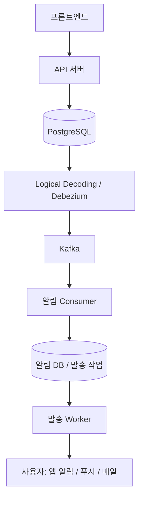

## 🥑 들어가며

이전에 [PostgreSQL CDC 파이프라인 톺아보기]()에서 DB 변경이 외부로 전달되는 과정을 정리했다. 그러면 이 변경을 받아서 사용자에게 알림을 보내는 것도 가능하지 않을까? 주문 상태가 배송 중으로 바뀌면 배송 시작 알림을 보내는 식이다.

연결 자체는 가능하다. 그런데 테이블이 바뀔 때마다 알림을 보내면, 내부 메모만 수정하거나 과거 데이터를 보정했을 때도 알림이 나갈 수 있다. 같은 변경을 두 번 받는 경우도 생각해야 한다.

배송 알림을 예로 들어 CDC 뒤에 어떤 처리가 필요한지 정리해봤다. 아직 구현한 내용은 아니고, 설계를 가정해서 살펴본 글이다.

<br>

## 1. DB 변경은 어떻게 전달될까

PostgreSQL에서는 WAL을 논리적인 변경으로 해석해 외부로 전달한다. DB가 제공하는 복제 연결을 통해 변경 스트림을 받는 방식이다. 여기서 읽는 로그는 API 서버의 `application.log`와는 다르다. [PostgreSQL Logical Decoding 문서](https://www.postgresql.org/docs/18/logicaldecoding-explanation.html)

예를 들어 Debezium과 Kafka를 사용하면 다음과 같이 구성할 수 있다.



알림 처리는 **커밋이 확정된 변경**을 기준으로 시작해야 한다. WAL 기록이 생겼다는 사실만으로 발송하면 안 된다. 트랜잭션이 롤백되면 사용자에게 알릴 변경도 성립하지 않기 때문이다.

API가 저장 성공 응답을 보냈더라도 알림은 아직 도착하지 않았을 수 있다. Consumer가 이벤트를 읽고 Worker가 발송할 때까지 시간이 걸리기 때문이다.

<br>

## 2. UPDATE가 생기면 무조건 알림을 보내도 될까?

주문 테이블에 다음 변경이 발생했다고 해보자.

```sql
UPDATE orders
SET status = 'SHIPPED'
WHERE id = 42;
```

사용자에게는 “주문한 상품의 배송이 시작됐어요”라고 알려주고 싶다. 그런데 주문 테이블에는 배송 시작 외에도 여러 변경이 발생한다.

| 변경 내용 | 이 예시에서의 배송 시작 알림 |
| --- | --- |
| `PAID → SHIPPED` | 발송 |
| 배송 중인 주문의 내부 메모 수정 | 발송하지 않음 |
| 이미 `SHIPPED`인 주문에 같은 상태 재저장 | 발송하지 않음 |
| 운영자가 과거 데이터를 일괄 보정 | 별도 정책으로 판단 |

따라서 `orders`에 UPDATE가 생겼는지, 변경 후 상태가 `SHIPPED`인지만 확인해서는 부족하다. **어떤 상태 전이가 일어났는지**를 판단해야 한다.

변경 전후 값을 받을 수 있다면 조건을 이렇게 쓸 수 있다.

```python
def is_shipping_started(event):
    if event.operation != "UPDATE":
        return False
    return (
        event.before["status"] == "PAID"
        and event.after["status"] == "SHIPPED"
    )
```

이때 `before`에 모든 컬럼이 들어온다고 가정하면 안 된다. PostgreSQL의 이전 값 제공 범위는 `REPLICA IDENTITY` 설정 등에 영향을 받는다. 이전 상태가 필요한 설계라면 해당 값이 실제 이벤트에 포함되는지 확인해야 한다. `FULL` 설정도 로그량 증가를 함께 고려해야 한다. [Debezium PostgreSQL Connector 문서](https://debezium.io/documentation/reference/stable/connectors/postgresql.html)

이전 값이 없다고 그 시점에 주문 테이블을 다시 조회하는 것도 같은 결과를 보장하지 않는다. Consumer가 읽을 때는 주문이 이미 `DELIVERED`로 바뀌었을 수 있다. 그때 조회한 값으로는 배송이 시작될 당시의 상태를 알 수 없다.

<br>

## 3. 배송 시작 이벤트를 Outbox에 남기기

Row 변경만 보고 사용자의 행동이나 업무 의도를 알아내기는 어렵다. 같은 `PAID → SHIPPED`라도 실제 배송 시작인지, 과거 데이터 보정인지 구분할 정보가 없을 수 있다.

애플리케이션에서 배송을 시작할 때 주문 상태를 바꾸고, `OrderShipped` 이벤트도 Outbox에 함께 남기면 어떨까?

```txt
하나의 DB 트랜잭션
  ├─ orders: 배송 상태 변경
  └─ outbox: OrderShipped 이벤트 INSERT
              ↓ COMMIT
        CDC로 outbox 변경 전달
              ↓
        알림 Consumer
```

DB 저장은 끝났는데 메시지를 보내기 전에 서버가 죽으면 이벤트가 누락될 수 있다. Outbox를 쓰면 주문 변경과 이벤트가 함께 커밋되므로, 서버가 죽어도 다시 전달할 이벤트가 DB에 남는다. 물론 남아 있는 이벤트를 재시도하는 처리는 필요하다. [AWS Transactional Outbox 설명](https://docs.aws.amazon.com/prescriptive-guidance/latest/cloud-design-patterns/transactional-outbox.html)

알림에 필요한 정보를 담아 이벤트를 정의해봤다. 아래는 애플리케이션에서 사용할 예시이며, Debezium의 기본 메시지 형식은 아니다.

```json
{
  "eventId": "order-42-shipped-v7",
  "eventType": "OrderShipped",
  "aggregateId": "42",
  "aggregateVersion": 7,
  "recipientId": "user-100",
  "occurredAt": "2026-11-18T10:00:00+09:00",
  "schemaVersion": 1
}
```

`eventId`는 같은 이벤트가 재전달돼도 유지하고, 새로운 사건에는 새로운 값을 부여한다. `aggregateVersion`은 주문 안에서의 변경 순서를 판단하는 용도다. API 요청 자체가 재시도될 때도 실제 상태 전이가 성공한 경우에만 이벤트를 기록하도록 해야 한다.

Debezium의 Outbox Event Router는 Outbox 레코드를 메시지로 변환하는 기능을 제공한다. 이벤트 ID를 중복 제거에 활용하고, 주문 ID 같은 aggregate ID를 메시지 키로 사용할 수 있다. [Outbox Event Router 문서](https://debezium.io/documentation/reference/stable/transformations/outbox-event-router.html)

이 구조에서는 Outbox에 배송 시작이라는 사건을 남기고, CDC가 그 레코드를 Kafka로 전달한다.

<br>

## 4. 같은 이벤트를 두 번 받아도 알림은 하나만 만들기

Consumer가 알림을 저장한 직후, Kafka Offset을 커밋하기 전에 종료됐다고 해보자.

```txt
이벤트 수신 → 알림 저장 → 프로세스 종료
                              ↓
재시작 → 같은 이벤트 재수신 → 알림을 또 저장할까?
```

재수신한 이벤트로 다시 INSERT하면 같은 알림이 두 개 생긴다. 이를 막기 위해 알림 DB에 고유 제약을 둘 수 있다.

```sql
UNIQUE (event_id, recipient_id, channel)
```

같은 사건을 같은 사용자에게 같은 채널로 보내는 작업은 한 번만 만든다는 뜻이다. 하나의 사건에서 같은 채널로 여러 알림을 만들어야 한다면 알림 종류 등도 키에 포함해야 한다.

Consumer의 처리 순서는 다음과 같이 설계한다.

1. 이벤트를 받아 수신 대상과 알림 정책을 판단한다.
2. 알림 DB 트랜잭션에서 사용자 알림과 발송 작업을 함께 저장한다. 중복 키라면 기존 작업을 유지한다.
3. DB 커밋이 성공한 뒤 해당 메시지까지의 Kafka Offset을 커밋한다.
4. Worker가 저장된 발송 작업을 읽어 외부 채널로 보낸다.

DB 커밋 전에 실패하면 다시 처리하고, DB 커밋 후 Offset 커밋 전에 실패하면 고유 제약으로 중복 생성을 막는다. 처리 완료 여부를 별도 테이블에 기록한다면 그것도 알림·발송 작업과 **같은 트랜잭션**에 묶어야 한다.

파티션 내 메시지를 병렬 처리할 때는 앞선 메시지가 아직 저장되지 않았는데 뒤쪽 Offset부터 커밋하지 않도록 주의한다. 재시작 때 미처리 메시지를 건너뛸 수 있기 때문이다.

<br>

## 5. DB에는 하나인데 푸시가 두 번 온다면

알림 Row를 하나만 만들었다고 해서 푸시도 반드시 한 번만 도착하는 것은 아니다.

```txt
Worker → 외부 발송 서비스: 푸시 요청
외부 발송 서비스: 요청 접수 성공
Worker: 응답을 받기 전에 타임아웃
```

이때 Worker는 발송 서비스가 요청을 처리했는지 확신할 수 없다. 재시도하면 중복될 수 있고, 재시도하지 않으면 누락될 수 있다. 로컬 DB 트랜잭션만으로 외부 서비스 호출까지 원자적으로 묶을 수는 없다.

발송 단계에서는 다음 처리가 필요하다.

- 제공자가 멱등성 키를 지원하면 같은 발송 작업 ID를 재시도에도 사용한다. 보장 기간과 범위도 확인한다.
- 요청 ID로 처리 결과를 조회할 수 있다면, 결과가 불명확한 요청을 먼저 조회한다.
- 여러 Worker가 같은 작업을 동시에 가져가지 않도록 잠금이나 만료 시간이 있는 점유 처리를 둔다.
- 일시적 실패는 간격을 늘리며 재시도하고, 영구 실패나 재시도 한도 초과는 별도 보관해 조사한다.

발송 서비스가 요청을 받았다고 사용자가 알림을 읽은 것은 아니다. 접수 성공, 기기 도착, 읽음 중 어디까지 확인할 것인지도 정해야 한다. 알림 목록은 DB 조회로 복구할 수 있게 하고, 푸시나 SSE/WebSocket은 새 알림을 빠르게 알려주는 수단으로 두면 연결이 끊겼던 사용자도 다시 목록을 확인할 수 있다.

<br>

## 6. 알림에서 특히 조심해야 하는 초기 적재와 재처리

### 과거 주문을 오늘의 배송 알림으로 보내지 않기

CDC를 처음 연결하면 기존 데이터의 Snapshot을 읽는 구성이 있을 수 있다. Debezium의 Snapshot 읽기 이벤트는 일반 INSERT와 구분되는 `op = r`로 표현된다. 이를 새 배송 사건으로 해석하면 과거 주문에 대한 알림을 한꺼번에 보낼 수 있다. [Debezium Snapshot 및 이벤트 형식](https://debezium.io/documentation/reference/stable/connectors/postgresql.html)

주문 테이블을 직접 감지한다면 Snapshot은 초기 상태를 읽는 데만 쓰고 알림은 보내지 않도록 할 수 있다. 그런데 Outbox는 사정이 다르다. Snapshot에 아직 보내지 않은 이벤트가 들어 있을 수 있어서 무조건 버릴 수 없다. 어디까지 발송됐는지 기존 처리 기록과 도입 시점을 확인해야 한다.

### 순서가 바뀌거나 오래 지연된 알림

주문별 순서가 필요하다면 Kafka 메시지 키를 주문 ID로 두고 같은 파티션에서 처리하도록 설계할 수 있다. 이후 Worker 병렬 처리나 별도 재시도 경로에서도 순서가 유지되는지는 따로 확인해야 한다.

이미 배송 완료 알림이 나간 뒤 지연된 배송 시작 이벤트가 도착했다면 어떻게 할까? 이 예시에서는 주문 버전과 이벤트 발생 시각을 확인해 오래된 배송 시작 알림을 생략할 수 있다. 반면 결제 영수증처럼 늦어도 전달해야 하는 알림에는 같은 규칙을 적용하면 안 된다.

또한 운영자가 과거 이벤트를 재생할 때 알림까지 다시 보낼 것인지 정해야 한다. 상태 복원용 재처리와 실제 발송 경로를 분리하고, 중복 제거 기록의 보존 기간도 허용할 재처리 기간에 맞추는 편이 안전하다.

<br>

## 7. 구현할 때 확인할 것

이 구조를 구현한다면 정상적인 배송 상태 변경뿐 아니라 다음 상황도 검증하고 싶다.

| 상황 | 확인할 결과 |
| --- | --- |
| 주문 변경 트랜잭션 롤백 | 알림이 생성되지 않음 |
| 같은 이벤트를 두 번 전달 | 동일한 수신자·채널의 발송 작업은 하나 |
| 알림 저장 직후 Consumer 종료 | 재수신해도 작업이 중복 생성되지 않음 |
| 발송 서비스 접수 후 응답 유실 | 불확실한 결과에 대한 조회·재시도 정책 적용 |
| 초기 Snapshot 또는 과거 이벤트 재생 | 정한 전환·재처리 정책대로만 발송 |
| 배송 완료 이후 배송 시작 이벤트 처리 | 알림 종류에 맞는 지연·순서 정책 적용 |

알림이 늦을 때는 어느 단계에서 밀렸는지 찾아야 한다. CDC 지연, Kafka Consumer Lag, 발송 작업이 대기한 시간, 채널별 실패율을 각각 확인할 필요가 있다. Kafka까지 전달됐어도 발송 Worker가 멈췄다면 사용자에게는 알림이 오지 않는다.

Replication Slot의 WAL 보존량도 함께 살펴야 한다. 다만 **Kafka를 읽는 알림 Consumer의 중단과 DB에서 읽는 CDC Connector의 중단은 다른 장애**다. 전자는 주로 Kafka 쪽 지연·보존 기간을, 후자는 DB 쪽 WAL 누적을 확인하게 된다. 두 구간의 장애가 연쇄적으로 번질 수도 있으므로 각각의 진행 상태를 관찰해야 한다.

<br>

## 마치며

처음에는 DB 변경을 받아서 알림만 보내면 될 것 같았다. 그런데 배송 상태가 바뀐 이유를 구분하고, 같은 이벤트를 다시 받았을 때와 발송 결과를 모를 때의 처리까지 생각하니 CDC 이후에 할 일이 더 많았다.

이미 CDC를 쓰고 있다면 여기에 알림 Consumer를 붙여볼 수 있겠다. 알림 때문에 CDC와 Kafka를 새로 운영해야 한다면, 우선 Outbox를 Worker가 주기적으로 읽는 방식도 생각해볼 만하다. 이 경우에도 보낼 사건은 DB에 남고, 중복 처리와 발송 재시도는 똑같이 필요하다.
